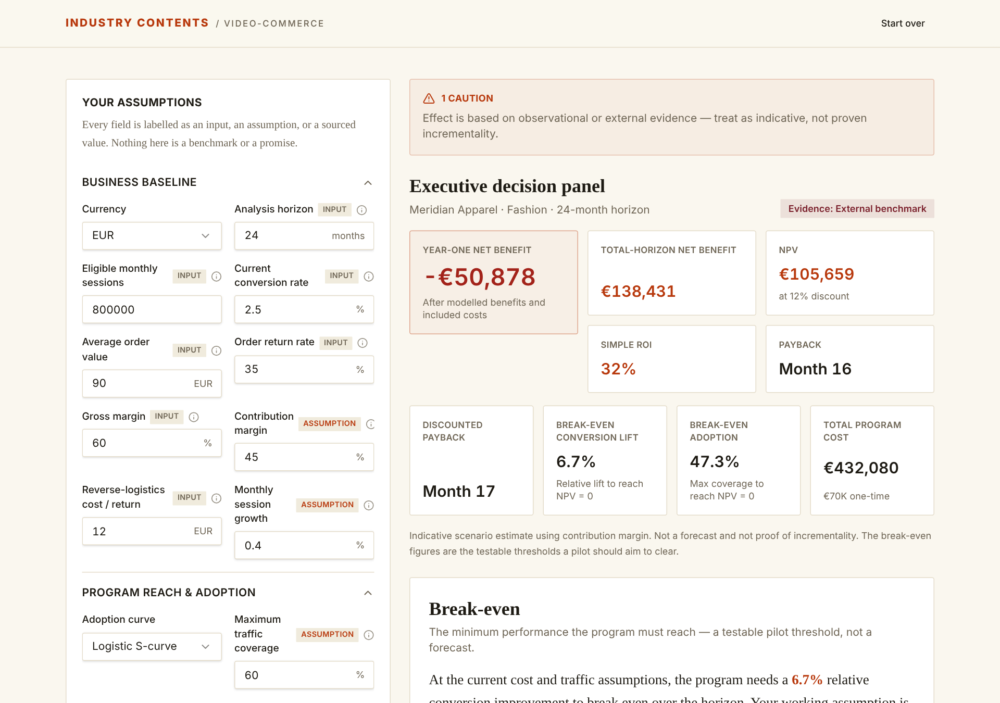
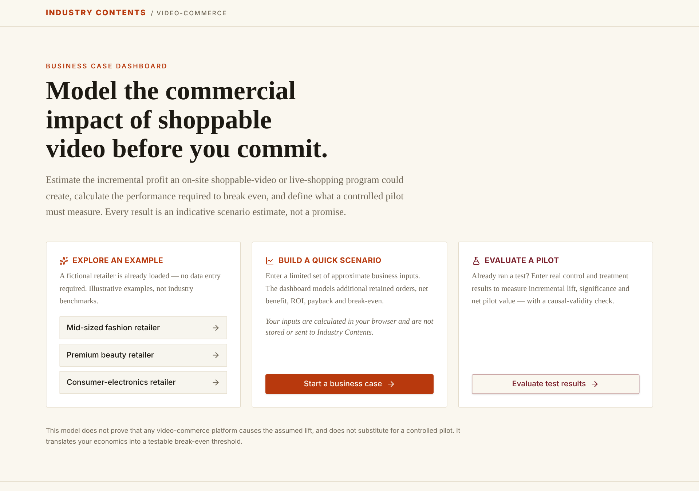

# Video Commerce ROI Dashboard

[](https://github.com/industry-contents/video-commerce-roi-dashboard/actions/workflows/ci.yml)
[](LICENSE)

A browser-based business case model for shoppable video and live shopping. It estimates incremental profit, payback and the conversion lift a program needs to break even, then turns the result into a measurement plan for a controlled pilot.

Built by [Industry Contents](https://industrycontents.com) and published through [IC Lab](https://industrycontents.com/ic-lab/).



<details>
<summary>Start screen</summary>



</details>

## What it calculates

- **Incremental contribution** from conversion lift, return-rate change and order-value change, after a confidence haircut on the modelled effect.
- **Break-even requirements:** the relative lift, percentage-point change, incremental retained orders and monthly benefit needed to cover total cost.
- **Cash flow over the horizon:** monthly net and cumulative cash flow, discounted cash flow and payback period.
- **Scenarios:** conservative, working and strong cases side by side.
- **Sensitivity:** which inputs move the result most.
- **Pilot design:** what a controlled test must measure before the program is scaled.

Inputs are labelled by evidence type (company history, randomized experiment, external benchmark, internal assumption, illustrative example), so assumptions stay visible next to the output.

## Privacy

All calculations run in the browser. The app makes no network requests with your inputs and stores nothing on a server.

## Stack

React 19, TypeScript, TanStack Start, Vite, Tailwind CSS 4, shadcn/ui.

## Getting started

```sh
git clone https://github.com/industry-contents/video-commerce-roi-dashboard.git
cd video-commerce-roi-dashboard
npm ci
npm run dev
```

| Command | Purpose |
| --- | --- |
| `npm run dev` | Start the development server |
| `npm run build` | Production build |
| `npm run lint` | Run ESLint |
| `npm run format` | Format with Prettier |

## Model

The calculation engine lives in `src/lib/model/`, separate from the interface:

| File | Role |
| --- | --- |
| `types.ts` | Input and result types |
| `engine.ts` | Monthly cash-flow engine |
| `breakeven.ts` | Break-even solver |
| `sensitivity.ts` | One-at-a-time sensitivity analysis |
| `pilot.ts` | Pilot design output |
| `examples.ts` | Illustrative fictional retailers |

The bundled examples are fictional and illustrative, not industry benchmarks.

## Contributing

Issues and pull requests are welcome. Please run `npm run lint` and `npm run build` before submitting.

## Security

See [SECURITY.md](SECURITY.md) to report a vulnerability.

## License

[MIT](LICENSE) © Yajush Gupta
